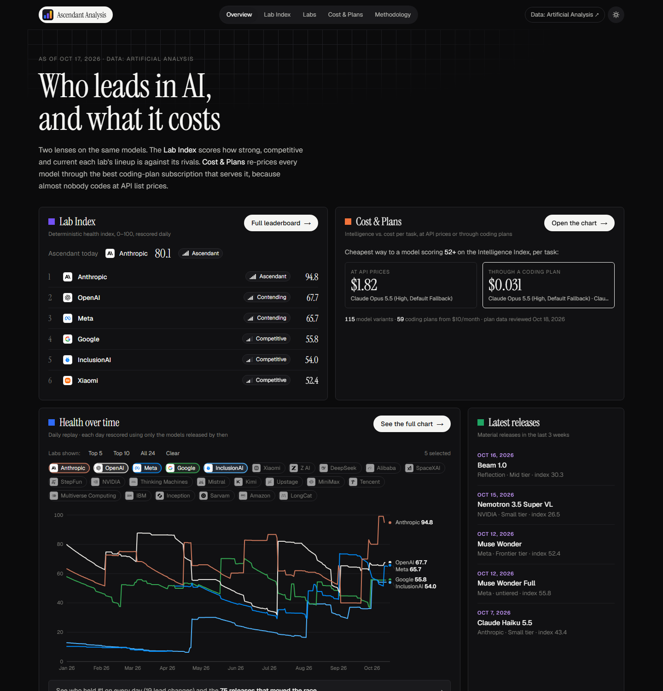
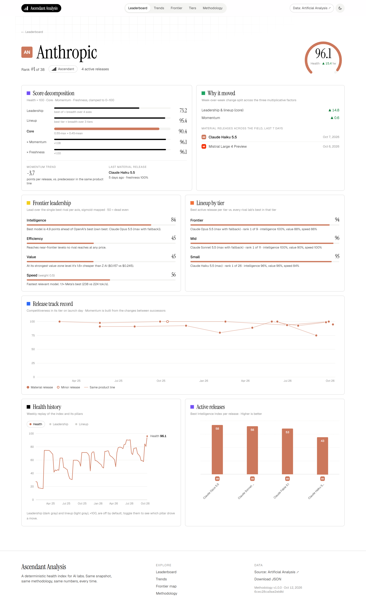
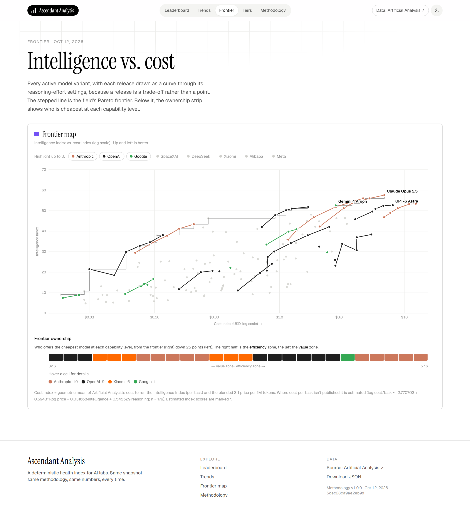

# Ascendant Analysis

A deterministic **health index for AI labs**: how strong, competitive and current each lab's
model lineup is against its rivals, computed only from [Artificial Analysis](https://artificialanalysis.ai)
benchmarks, prices and speeds.



| Lab page | Frontier map |
|---|---|
|  |  |

```
pipeline/   Python: ingest → normalize → score → replay → export (uv)
web/        Next.js static site that renders the exported JSON
config/     methodology.v1.yaml (every constant), labs, overrides, perception reference
data/       content-hashed snapshots (committed)
Dockerfile, railway.json, sws.toml   one-click Railway deploy (static, no key)
update.ps1  local refresh: snapshot → test → export → commit → push
```

## How the index works

`Health = 100 · Core · Momentum · Freshness`

- **Leadership:** lead over the best rival on intelligence, near-frontier cost efficiency,
  value-zone cost and speed (frontier ownership on a 1-point capability grid). Winning one axis
  is enough to score well.
- **Lineup:** each lab's best release per tier (frontier / mid / small, from price natural
  breaks fixed at launch), scored against rivals on intelligence, value residual and speed.
- **Core:** a soft-max of the two, so a specialist that wins its niche can still be healthy.
- **Momentum (×0.8–1.2):** the trend in at-release competitiveness between successive
  releases of the same product line.
- **Freshness (×0.6–1.0):** decays with a 60-day half-life after a 30-day grace period since
  the last *material* release.

The full write-up is on the site's Methodology page.

## Run it

```bash
cd pipeline
uv sync
uv run ascendant ingest        # needs AA_API_KEY (env var or ../.env)
uv run ascendant score         # print today's table
uv run ascendant verify        # determinism gate (shuffled inputs → identical hashes)
uv run ascendant export        # writes web/public/data/*.json
uv run pytest
```

```bash
cd web
npm ci
npm run dev                    # http://localhost:3000
npm run build                  # static site in web/out
```

## Deploy on Railway

The site is fully static and the scored data is committed (`web/public/data`), so the server
needs no API key and runs no pipeline.

1. In Railway: **New Project → Deploy from GitHub repo →** pick this repository.
2. Railway reads `railway.json` and builds the `Dockerfile`; nothing to configure.
3. **Settings → Networking → Generate Domain.**

The image builds the Next.js site on Railway's builder, pre-compresses it (gzip + brotli), and
serves it with [static-web-server](https://static-web-server.net). At runtime it's one small
Rust process: about 8 MB of RAM and near-zero CPU, with no per-request compression. HTML and
data revalidate (`no-cache`), hashed assets cache for a year, and `/health` serves the
Railway health check.

## Updating the data

Updates happen only when you run them locally. Railway redeploys on every push.

```powershell
./update.ps1             # fetch today's snapshot, test, verify, export, build, commit, push
./update.ps1 -NoPush     # same, but don't push
./update.ps1 -NoFetch    # rescore the latest snapshot (e.g. after a config change)
```

Fetching needs `AA_API_KEY` locally (env var or a git-ignored `.env`).

## Determinism

Scoring is a pure function of (snapshot, config): pure-Python arithmetic, stable tie-breaks,
6-dp rounding at stage boundaries, and no wall-clock time. `ascendant verify` rebuilds the
export three times, twice with shuffled input order, and fails unless the hashes match; the
update script refuses to publish otherwise. Changing any constant means bumping
`methodology.version`.

Data: Artificial Analysis (attribution required by their API terms).
