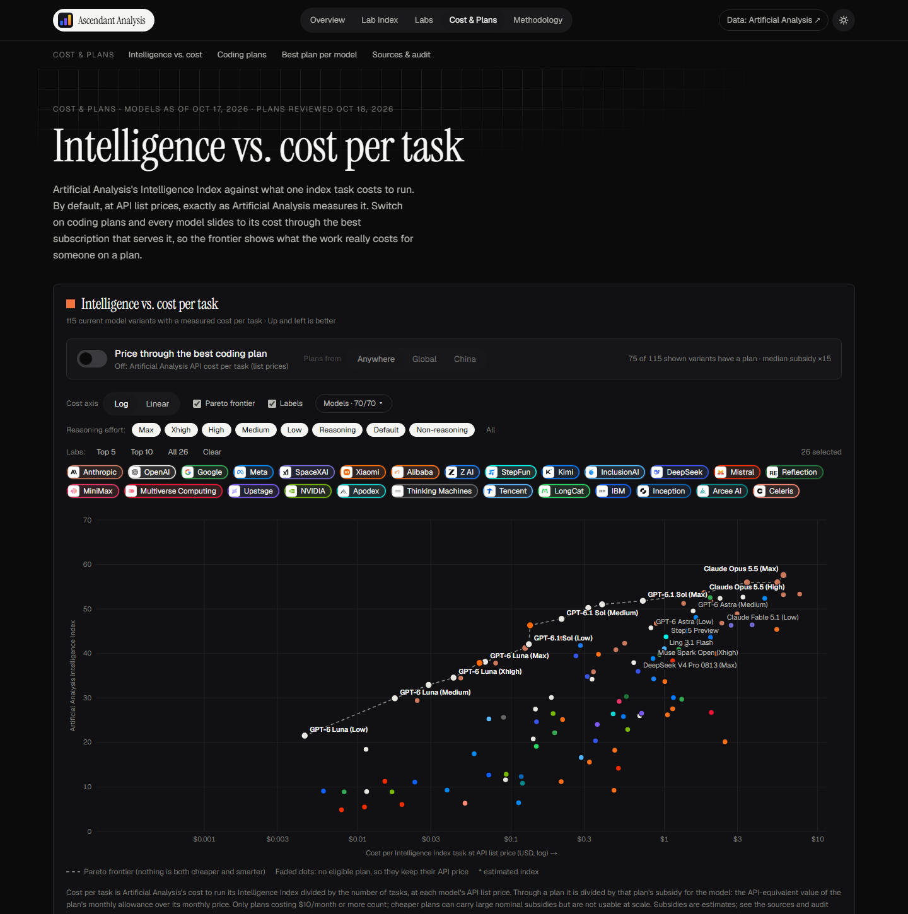
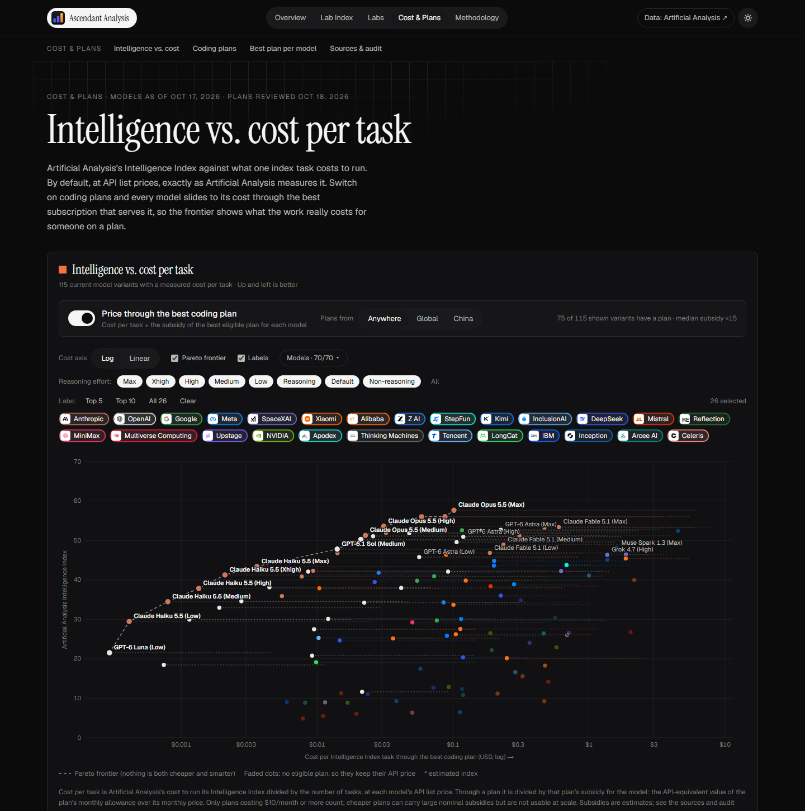
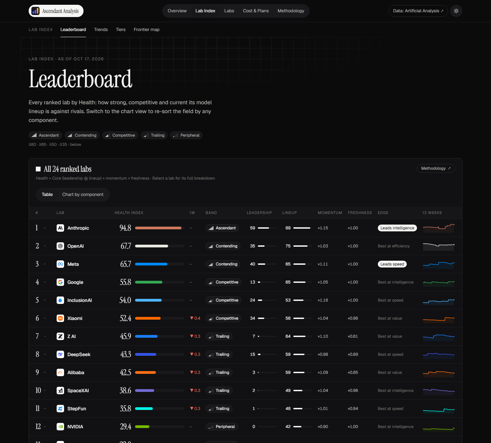

# Ascendant Analysis

Two lenses on the same AI models, built from [Artificial Analysis](https://artificialanalysis.ai) data:

- **Lab Index:** a deterministic health index for AI labs: how strong, competitive and current each
  lab's model lineup is against its rivals.
- **Cost & Plans:** Artificial Analysis's Intelligence vs. cost-per-task chart, with a switch that
  re-prices every model through the best coding-plan subscription that serves it (Claude Code,
  Codex, OpenCode Go, GLM Coding Plan, ...), plus a catalog of every plan's price, subsidy, lineup,
  limits and sources.


| Cost & Plans, API prices | Cost & Plans, through coding plans |
|---|---|
|  |  |

| Leaderboard | Lab page |
|---|---|
|  |  |

```
pipeline/   Python: ingest → normalize → score → replay → export (uv)
web/        Next.js static site that renders the exported JSON
config/     methodology.v1.yaml (every constant), labs, overrides, perception reference,
            coding_plans.yaml (hand-reviewed coding-plan subsidies, with sources)
data/       content-hashed snapshots, plans/check.json (latest plan audit), all committed
update.ps1  local refresh: snapshot → test → export → commit → push
.github/    workflow: daily snapshot → test → export → commit → build → GitHub Pages
```

## How the index works

`Health = 100 · Core · Momentum · Freshness`

- **Leadership:** lead over the best rival on intelligence, near-frontier cost efficiency,
  value-zone cost and speed (frontier ownership on a 1-point capability grid). Winning one axis
  is enough to score well.
- **Lineup:** each lab's best-scoring release per tier (frontier / mid / small, by the release's own blended
  price against fixed cut-offs), scored against rivals on intelligence, value residual and speed.
- **Core:** a soft-max of the two, so a specialist that wins its niche can still be healthy.
- **Momentum (×0.75–1.25):** the trend in at-release competitiveness between successive
  releases of the same product line.
- **Freshness (×0.5–1.0):** decays with a 45-day half-life after a 21-day grace period since
  the last *material* release.

The full write-up is on the site's Methodology page.

## Cost & Plans

- **Models:** every current model variant with a measured cost per Intelligence Index task (from the
  same leaderboard snapshot), one dot per reasoning effort.
- **Subsidy** of plan *p* for model *m* = API-equivalent value of *p*'s monthly allowance for *m* ÷
  *p*'s monthly price. Cost through a plan = API cost per task ÷ the best eligible plan's subsidy.
  "Best" ranks by multiplier × a confidence weight (official/measured 1.0, derived 0.85, estimate 0.6,
  unknown 0.5), so a generic derived figure cannot win just by being bigger; the raw multiplier is shown.
  Only plans at **$10/month or more** count, and a plan only reprices models in its own lineup.
- **Data:** `config/coding_plans.yaml` is reviewed by hand and **never updated automatically**. Each
  plan cites dated sources and says how its multiplier was derived (official / measured / derived /
  estimate). Per-model multipliers are kept where they differ (OpenCode Go's per-model caps, Claude
  Fable's separate cap, GLM's credit weights, ...). Every plan has one committed number per model
  (no ranges or blanks), and tiers the provider scales linearly with price share one multiplier, so
  a stated tier ratio (e.g. "5× Pro at 5× the price") is kept exactly.
- **Audit:** `uv run ascendant plans-check` (daily in CI, non-blocking) compares the pinned values with
  Devforth's crowd-measured limits (`devforth_baseline` = what Devforth showed at review time), probes
  every source URL and flags plans not re-verified for 90 days. Flags appear as workflow annotations
  and on the site; a person decides what to change.

## Run it

```bash
cd pipeline
uv sync
uv run ascendant ingest        # needs AA_API_KEY (env var or ../.env)
uv run ascendant score         # print today's table
uv run ascendant verify        # determinism gate (shuffled inputs → identical hashes)
uv run ascendant plans-check   # audit coding-plan data (network; never edits it)
uv run ascendant export        # writes web/public/data/*.json
uv run pytest
```

```bash
cd web
npm ci
npm run dev                    # http://localhost:3000
npm run build                  # static site in web/out
```

## Deploy on GitHub Pages

The site is fully static and the scored data is committed (`web/public/data`), so hosting needs
no server and no key. One workflow, `.github/workflows/site.yml`, does everything for free:

- **Daily (09:17 UTC) or manual run:** fetch a snapshot, test, verify determinism, export,
  commit the data if it changed, build the site and deploy it to Pages.
- **Push to `main`** (code, config or data): rebuild and deploy, without fetching.

One-time setup:

1. **Settings → Pages → Build and deployment → Source: GitHub Actions.**
2. **Settings → Secrets and variables → Actions → New repository secret:** `AA_API_KEY`.
3. Run it once: **Actions → Update and deploy → Run workflow.**

The site is served at `https://<user>.github.io/<repo>/`; the workflow builds with that base
path. For a custom domain or a `<user>.github.io` repo, add the repository variable
`PAGES_BASE_PATH` = `/`.

Scheduled workflows are disabled by GitHub after 60 days without repository activity; the daily
data commit counts as activity, so this only matters if the API fetch keeps failing.

## Updating the data by hand

```powershell
./update.ps1             # fetch today's snapshot, test, verify, export, build, commit, push
./update.ps1 -NoPush     # same, but don't push
./update.ps1 -NoFetch    # rescore the latest snapshot (e.g. after a config change)
```

Fetching needs `AA_API_KEY` locally (env var or a git-ignored `.env`). The push triggers the
workflow, which redeploys the site.

## Determinism

Scoring is a pure function of (snapshot, config): pure-Python arithmetic, stable tie-breaks,
6-dp rounding at stage boundaries, and no wall-clock time. `ascendant verify` rebuilds the
export three times, twice with shuffled input order, and fails unless the hashes match; the
update script refuses to publish otherwise. Changing any constant means bumping
`methodology.version`.

Data: Artificial Analysis (attribution required by their API terms).
